


  

 


<a href="https://camilogarcia079.github.io/portafolio/"></a>

Soy **Técnico en Desarrollo de Software e Inteligencia Artificial**, formado durante un año intensivo en **CampusLands** (Floridablanca). En **diciembre de 2026 empiezo mi etapa productiva en Globant**.

En palabras simples: **creo programas que hacen solos el trabajo repetitivo**. En lo técnico, eso es construir **APIs REST con Java 21 y Spring Boot**, protegidas con **Spring Security y JWT** y organizadas con **arquitectura hexagonal**; **flujos de automatización en n8n** que reciben eventos por webhook desde Telegram y guardan en Google Sheets; **agentes de IA en TypeScript** que usan *tool calling* para consultar datos reales en lugar de inventarlos; y cadenas con **LangChain en Python** cuya respuesta se valida con Pydantic. Trabajo con **MySQL y PostgreSQL** (migraciones versionadas con Flyway) y comunicación en tiempo real con **WebSockets**.

Dejo cada proyecto listo para que otra persona lo ejecute: **pruebas automatizadas** con JUnit 5 y pytest (más de 850 entre mis repositorios), **contenedores con Docker**, la API documentada con **Swagger** y las decisiones técnicas escritas.

 

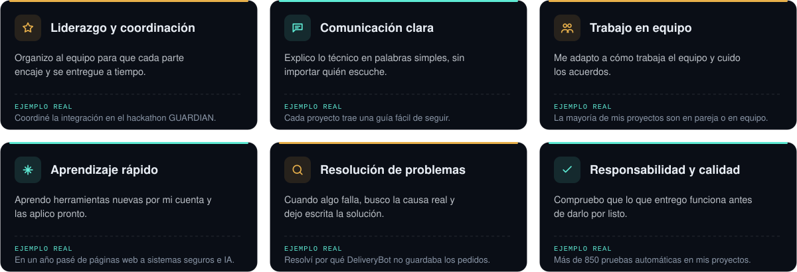

 

  <a href="https://github.com/CamiloGarcia079/Evaluacion-Springboot-Herramientas---Camilo-Garcia-Almeida/tree/main/src/main/java"></a>
  <a href="https://github.com/CamiloGarcia079/Hojas-de-vida-Chatbot---IA---Camilo-/tree/main/app/intermedio/cv_analyzer"></a>
  <a href="https://github.com/santiagoosorio0708e-wq/Vital-Route/tree/master/api"></a>
  <a href="https://github.com/CamiloGarcia079/CAMILO-BANCO-EVALUACION/tree/main/BANCO-ACME--main%20Camilo%20Garcia/js"></a>
  <a href="https://github.com/CamiloGarcia079/PROYECTO---EVALUACION-Camilo-Garc-a-/tree/main/sql"></a>


Haz clic en un lenguaje para ver el proyecto donde lo apliqué. Los lenguajes son las instrucciones que le doy a la computadora; las demás son herramientas para construir más rápido, guardar datos y comprobar que todo funciona. Cada una está usada en al menos un proyecto de abajo.

  



| Línea | Dónde se ve |
|---|---|
| **Automatización de procesos** | [DeliveryBot](https://github.com/CamiloGarcia079/Proyecto_DeliveryBot_GarciaCamilo): flujo de 39 nodos en n8n que toma pedidos por Telegram y los registra en Google Sheets. |
| **Bots y agentes de IA** | [VitalRoute](https://github.com/santiagoosorio0708e-wq/Vital-Route) y [Aduana-Copilot](https://github.com/CamiloGarcia079/Aduana-Copilot-CamiloGarcia-DanielOsorio): agentes que llaman herramientas y dejan los cálculos al código. [Analizador de CVs](https://github.com/CamiloGarcia079/Hojas-de-vida-Chatbot---IA---Camilo-) con LangChain y Gemini. |
| **Desarrollo web** | APIs REST con Spring Boot y Express, y frontends en React y JavaScript: [Renta de Herramientas](https://github.com/CamiloGarcia079/Evaluacion-Springboot-Herramientas---Camilo-Garcia-Almeida), [Banco ACME](https://github.com/CamiloGarcia079/CAMILO-BANCO-EVALUACION), [portafolio](https://github.com/CamiloGarcia079/portafolio). |

 

<a href="https://github.com/santiagoosorio0708e-wq/Vital-Route"></a>
<a href="https://github.com/CamiloGarcia079/trabajo-bound-context-con-spring-security"></a>
<a href="https://github.com/CamiloGarcia079/Evaluacion-Springboot-Herramientas---Camilo-Garcia-Almeida"></a>
<a href="https://github.com/CamiloGarcia079/Aduana-Copilot-CamiloGarcia-DanielOsorio"></a>
<a href="https://github.com/CamiloGarcia079/Proyecto_DeliveryBot_GarciaCamilo"></a>
<a href="https://github.com/CamiloGarcia079/Hojas-de-vida-Chatbot---IA---Camilo-"></a>
<a href="https://github.com/santiagoosorio0708e-wq/Formula1-java"></a>
<a href="https://github.com/CamiloGarcia079/CAMILO-BANCO-EVALUACION"></a>

**Otros proyectos**

| Proyecto | Qué es | Tecnologías |
|---|---|---|
| [Plataforma SST y PESV](https://github.com/CamiloGarcia079/PROYECTO---EVALUACION-Camilo-Garc-a-) | Base de datos multiempresa para seguridad en el trabajo y seguridad vial, con vistas, funciones y triggers. | PostgreSQL |
| [Tribuna Global](https://github.com/CamiloGarcia079/Tribuna-Global-Camilo-Garcia-A) | Chatbot que clasifica por sentimiento opiniones sobre futbolistas, sin guardar datos inventados si algo falla. | Python, LangChain, Gemini |
| [Portafolio](https://github.com/CamiloGarcia079/portafolio) | Sitio personal de una sola página. | HTML, CSS, JavaScript |

 

<table>
  <tr>
    <td width="96" align="center"></td>
    <td>
      <b>Etapa productiva · Globant</b> 
      Desde diciembre de 2026 
      Práctica profesional como desarrollador en una empresa global de tecnología.
    </td>
  </tr>
  <tr>
    <td width="96" align="center"></td>
    <td>
      <b>Técnico en Desarrollo de Software e Inteligencia Artificial · CampusLands</b> 
      Floridablanca · dic 2025 – nov 2026 · formación intensiva de un año 
      Java y Spring Boot, Python, JavaScript y TypeScript, bases de datos MySQL y PostgreSQL, automatización con n8n e inteligencia artificial aplicada.
    </td>
  </tr>
  <tr>
    <td width="96" align="center">RETO <b>2026</b></td>
    <td>
      <b>Reto Agente 2026 · Platica.mx con CampusLands · <a href="https://github.com/CamiloGarcia079/Aduana-Copilot-CamiloGarcia-DanielOsorio">Aduana-Copilot</a></b> 
      Proyecto en pareja con Daniel Osorio. Me encargué del agente, el gateway y la interfaz.
    </td>
  </tr>
  <tr>
    <td width="96" align="center">HACKATHON <b>IA</b></td>
    <td>
      <b>Hackathon presencial “Visual Agents” · <a href="https://github.com/andresguerra321/GUARDIAN">GUARDIAN</a></b> 
      Sistema predictivo de seguridad vial con visión por computadora (FiftyOne de Voxel51) y Gemini. Mi rol fue integración, contratos entre módulos y presentación: coordinar que las piezas del equipo funcionaran juntas, revisar el código antes de la entrega y presentar el resultado.
    </td>
  </tr>
</table>

 

**Bucaramanga, Santander, Colombia** 
**Correo:** [kaliko2411@gmail.com](mailto:kaliko2411@gmail.com) 
**LinkedIn:** [linkedin.com/in/camilo-garcia-7570693b7](https://www.linkedin.com/in/camilo-garcia-7570693b7/) 
**Portafolio:** [camilogarcia079.github.io/portafolio](https://camilogarcia079.github.io/portafolio/) (tiene un formulario para escribirme directamente) 
**Hoja de vida:** [descargar en PDF](https://camilogarcia079.github.io/portafolio/cv/HojaDeVida_ATS_CamiloGarcia.pdf)

 

